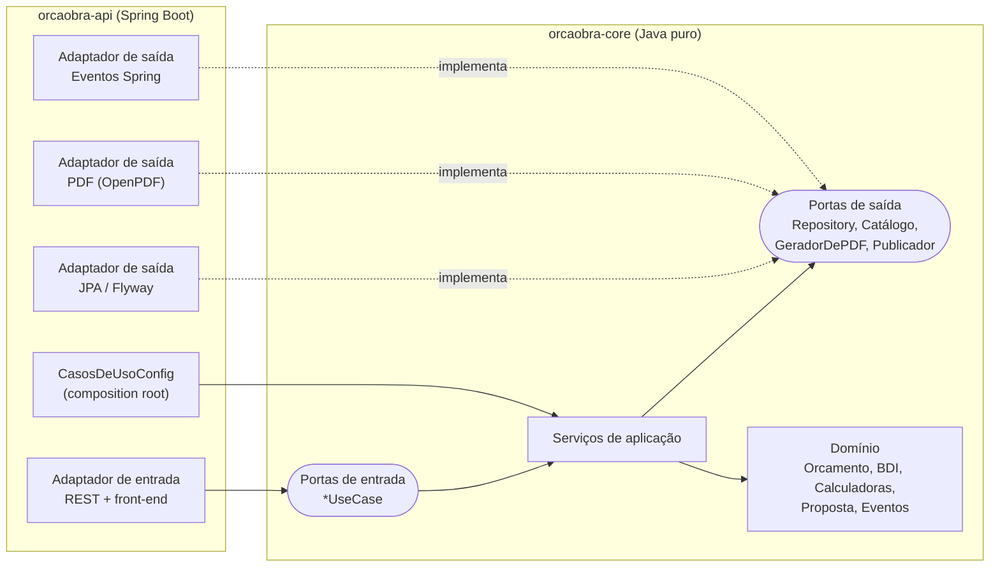
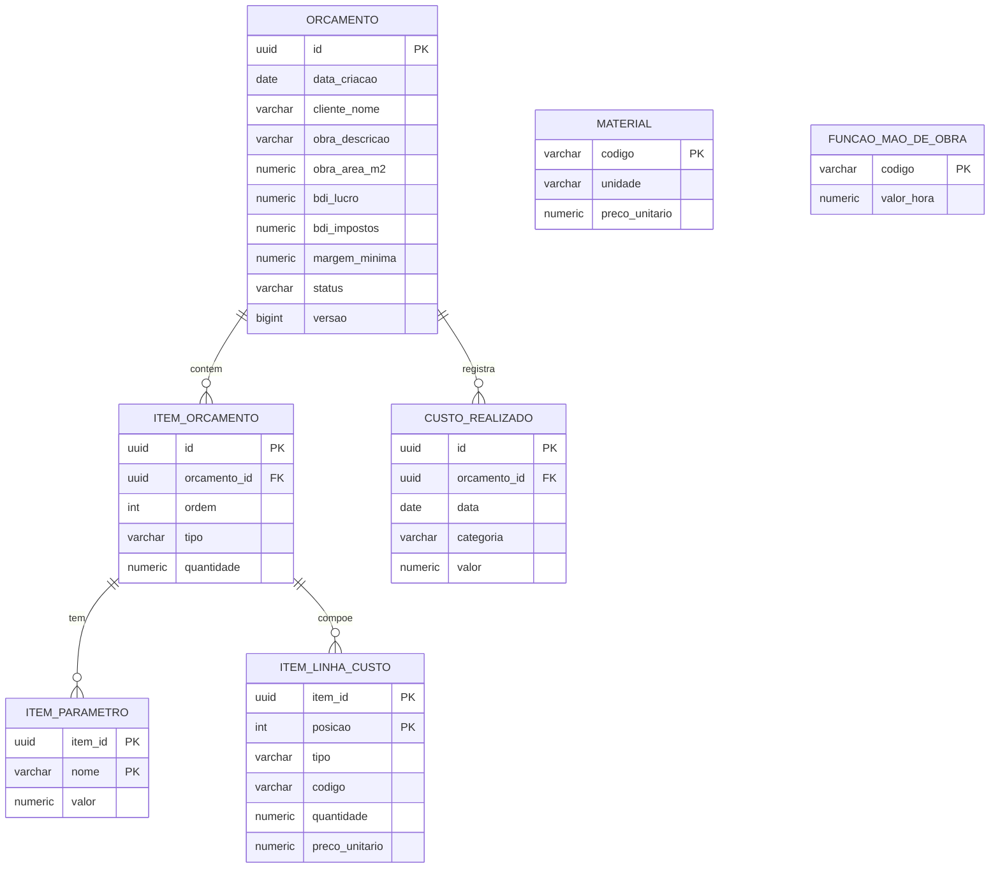
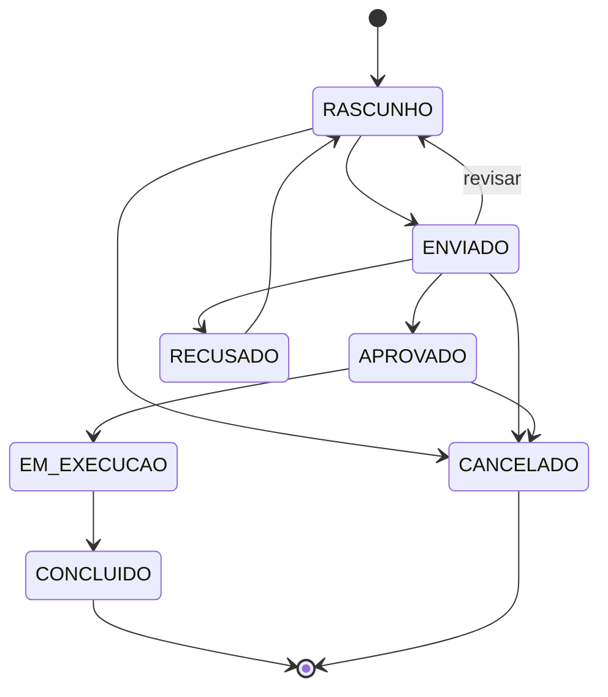
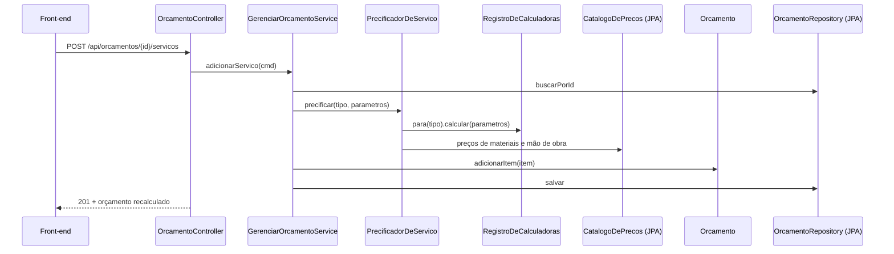

# Arquitetura — OrçaObra

## Visão geral: arquitetura hexagonal (portas e adaptadores)

O sistema é dividido em dois módulos Maven. A dependência só vai **de fora para dentro**: o núcleo
não conhece Spring, JPA, HTTP nem PDF. Isso é garantido de duas formas: o módulo `orcaobra-core`
não tem nenhuma dependência de produção no `pom.xml`, e o `ArquiteturaTest` (ArchUnit) quebra o
build se alguém violar a regra.

| Camada | Pacote | Responsabilidade |
|---|---|---|
| Domínio | `br.com.orcaobra.dominio` | Regras de negócio: cálculo de consumo, BDI, margem, ciclo de vida, proposta. |
| Aplicação | `br.com.orcaobra.aplicacao` | Casos de uso (orquestração) e portas (interfaces). |
| Adaptadores de entrada | `br.com.orcaobra.api.adaptador.entrada.web` | Controllers REST, DTOs, tratamento de erros. |
| Adaptadores de saída | `br.com.orcaobra.api.adaptador.saida.*` | JPA, PDF, eventos. |
| Configuração | `br.com.orcaobra.api.config` | Liga as portas aos adaptadores (injeção de dependência). |

**Por que hexagonal aqui?** O valor do produto está nas regras (quantitativos, BDI, margem). Com o
núcleo isolado, essas regras são testadas em milissegundos, sem subir servidor nem banco, e o banco,
o gerador de PDF ou a interface podem ser trocados sem tocar nelas.

## Padrões de projeto aplicados

| Padrão | Onde | Problema que resolve |
|---|---|---|
| **Strategy** | `CalculadoraDeServico` + 6 implementações em `dominio.servico.calculadoras` | Cada serviço tem uma regra de consumo diferente. Novo serviço = nova classe, sem `if/switch` espalhado (aberto/fechado). |
| **Factory / Registry** | `RegistroDeCalculadoras` | Escolhe a estratégia certa para cada `TipoServico`. |
| **Builder** | `Orcamento.builder()`, `ComposicaoServico.nova()` | Criação legível de objetos com muitos campos e valores padrão. |
| **State** | `StatusOrcamento` (enum com comportamento por constante) | Cada status decide o que é permitido e para onde pode ir; elimina condicionais de status no agregado. |
| **Observer** (eventos de domínio) | `EventoDeDominio`, `PublicadorDeEventos`, `AlertaDeMargemListener` | O domínio avisa "a margem caiu" sem saber quem vai reagir (log hoje; e-mail/WhatsApp amanhã). |
| **Template Method** | `PropostaPdfTemplate` → `PropostaPdfPadrao` | A ordem das seções da proposta é fixa; o layout de cada seção pode variar por subclasse. |
| **Adapter** | `OrcamentoRepositoryJpaAdapter`, `CatalogoJpaAdapter`, `PublicadorDeEventosSpring` | Adaptam tecnologias às portas do núcleo. |
| **Repository** | `OrcamentoRepository` | Abstrai a persistência do agregado. |
| **Value Object** | `Dinheiro`, `Percentual`, `ParametrosServico` | Imutáveis, com validação e aritmética corretas (BigDecimal). |
| **Aggregate Root** (DDD) | `Orcamento` | Toda alteração passa por ele, garantindo as regras de negócio. |
| **Data Mapper** | `OrcamentoMapper` | Separa o modelo de domínio do modelo JPA. |
| **DTO** | `Requisicoes`, `Respostas` | Contrato da API desacoplado do domínio. |
| **Composition Root / DI** | `CasosDeUsoConfig` | Único lugar onde o Spring conhece o núcleo. |

Princípios SOLID evidentes: **S** (cada caso de uso numa classe), **O** (Strategy e Template
Method), **L** (qualquer `CalculadoraDeServico` é intercambiável), **I** (portas pequenas e
específicas), **D** (serviços dependem de interfaces, não do JPA).

## Modelo de dados

`ITEM_LINHA_CUSTO` guarda o preço **do momento do cálculo** (RF05). Por isso não há chave
estrangeira para `MATERIAL`: o catálogo pode mudar ou um material pode sair dele sem afetar
orçamentos antigos.

## Ciclo de vida (State)

## Fluxo "adicionar serviço"

## Decisões registradas (ADR resumido)

1. **Dois módulos Maven** em vez de pacotes num só módulo — o compilador impede o núcleo de importar
   Spring por engano.
2. **Modelo JPA separado do domínio** — mais código de mapeamento, mas o domínio fica com construtores
   que validam regras, imutabilidade e nenhuma anotação.
3. **Preços congelados no item** — orçamento é um documento comercial; não pode mudar sozinho.
4. **BDI pela fórmula do TCU** — referência conhecida pelos engenheiros e auditável.
5. **Front-end em HTML/JS puro servido pelo próprio Spring Boot** — zero build extra; pode ser
   substituído por React/Flutter consumindo a mesma API.
